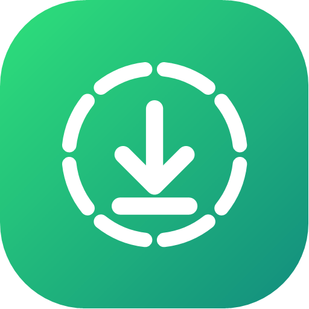
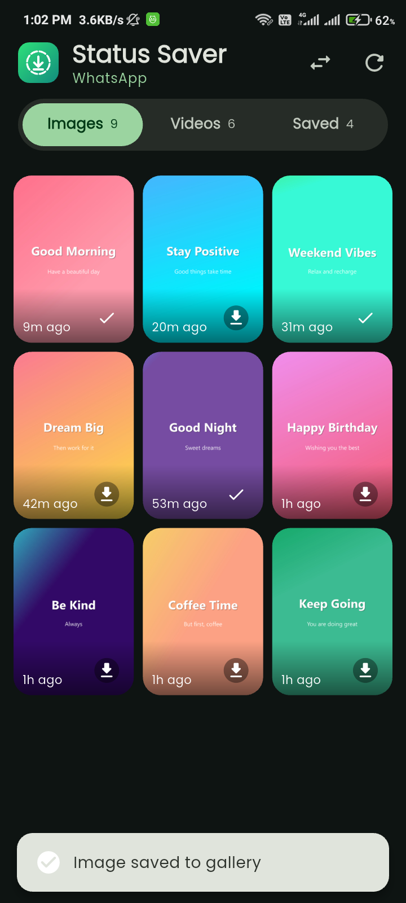
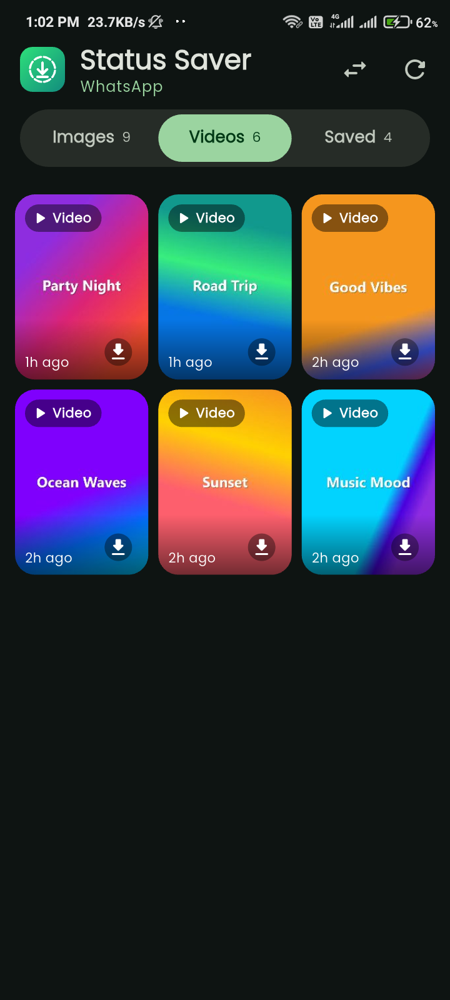
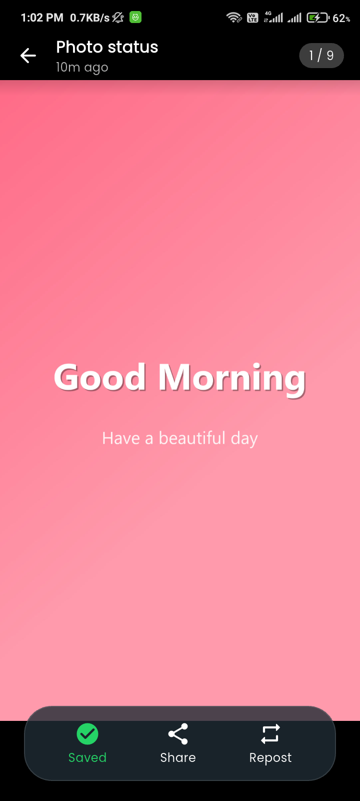
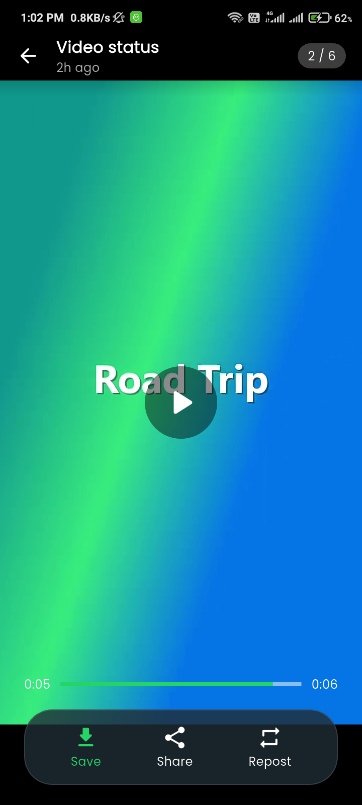
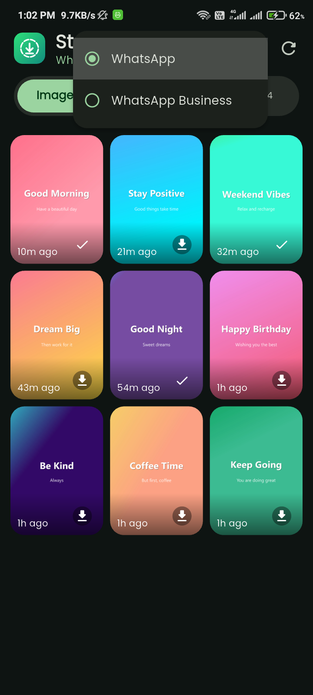

<p align="center">
  
</p>

<h1 align="center">Status Saver</h1>

<p align="center">
  A simple, clean Android app to view, preview, save and share WhatsApp statuses.<br/>
  Built with Flutter.
</p>

---

## Screenshots

| Images | Videos | Image preview |
|:---:|:---:|:---:|
|  |  |  |

| Video preview | WhatsApp / Business |
|:---:|:---:|
|  |  |

> Screenshots use generated sample content.

## Features

- **Images & Videos tabs**: every status you've viewed, newest first, with "time ago" labels
- **Full-screen preview**
  - Images: pinch or double-tap to zoom, swipe between statuses
  - Videos: autoplay, loop, tap to play/pause, seekable progress bar
- **One-tap save** to the gallery (`Pictures/StatusSaver` and `Movies/StatusSaver`), with saved items marked by a check
- **Saved tab**: browse and delete what you've saved
- **Share** through any app, or **Repost** straight back to WhatsApp
- **WhatsApp & WhatsApp Business** support
- Auto-refresh when you return to the app, plus pull-to-refresh
- Material 3 design with light and dark themes

## How it works

| Android version | Access method |
|---|---|
| 11 and newer | Storage Access Framework: you grant one-time access to the `.Statuses` folder, and it's remembered |
| 10 and older | Standard storage permission, reading `WhatsApp/Media/.Statuses` directly |

The app does **not** need `MANAGE_EXTERNAL_STORAGE` (all-files access). Everything runs on the device, and nothing is uploaded.

The native side (folder access, thumbnails, saving to MediaStore, sharing) lives in
[`MainActivity.kt`](android/app/src/main/kotlin/com/statussaver/status_saver/MainActivity.kt) and talks to Flutter over a `MethodChannel`.

## Getting started

**Requirements:** Flutter 3.x (Dart 3) and an Android device with WhatsApp installed.

```bash
git clone https://github.com/DimuthuWayaman/Whatsapp-Status-Saver.git
cd Whatsapp-Status-Saver
flutter pub get
flutter run
```

### Build a release APK

```bash
flutter build apk --release --split-per-abi
```

APKs are written to `build/app/outputs/flutter-apk/`. Most phones use `app-arm64-v8a-release.apk`.

> Release builds are currently signed with the debug key. Set up your own signing config before publishing to Google Play.

## Usage

1. Open WhatsApp and view some statuses.
2. Open **Status Saver**. On Android 11+, tap **Grant access**, then **Use this folder**, then **Allow**.
3. Tap any status to preview it, then **Save**, **Share** or **Repost**.

## Project structure

```
lib/
├── main.dart                  # App entry, theme
├── models/status_item.dart    # Status data model
├── services/status_service.dart  # State + MethodChannel bridge
├── screens/
│   ├── home_screen.dart       # Tabs, permission onboarding
│   └── preview_screen.dart    # Full-screen image/video viewer
└── widgets/
    ├── app_logo.dart          # Logo drawn with CustomPainter
    └── status_grid.dart       # Grid, tiles, thumbnails
```

## Disclaimer

This project is not affiliated with, endorsed by, or connected to WhatsApp or Meta. Please respect other people's privacy and only save or share content you have permission to use.
